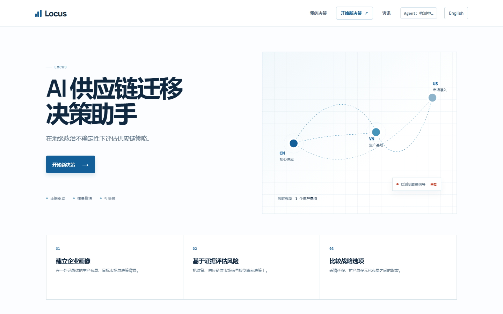

<div align="center">

# Locus

### 地缘政治供应链风险，转化为可执行的决策

面向制造业供应链负责人的 AI 决策支持 Agent。将政策证据、风险判断、情景推演、咨询补充与管理层报告串成一条可追溯的工作流。

[演示视频](https://www.bilibili.com/video/BV1LfHV6dE8A/) · [在线界面（API 已停用）](https://georisk-locus.netlify.app) · [API 文档](https://georisk-agent.onrender.com/docs) · [工作流说明](docs/workflow.md) · [示例输入](docs/examples/sample-input.json)


</div>

> [!IMPORTANT]
> - 本项目由团队在与 AI 的持续沟通中完成，AI 在架构设计、代码实现、测试和文档整理等环节提供了辅助。
> - 受经费限制，线上系统所依赖的 API 已于 **2026-11-11** 停止使用。在线页面可能仅展示本地预览，完整功能和交互效果请观看[演示视频](https://www.bilibili.com/video/BV1LfHV6dE8A/)。



## 作品集导览

| 展示重点 | 实现 |
| --- | --- |
| **Agentic Workflow** | Profile、Research、Risk、Scenario、Advisor、Verification 六阶段协同，后台任务可持久运行并支持刷新后续接。 |
| **Evidence-grounded RAG** | 组合 SQLite FTS5、metadata filtering、query enhancement 与 authority ranking；证据绑定来源、日期、权威等级和可点击原文。 |
| **可解释情景推演** | 使用五维评分与五档 Rubric 比较成本、韧性、地缘风险、市场准入和落地可行性，并保留证据、假设与置信度。 |
| **闭环咨询与版本** | 将对话中的新信息结构化，更新企业画像和缺口，重新推演情景并保存历史快照。 |
| **管理层报告** | 通过 Report Composer 生成五段式 PDF，将证据与打分明细收纳到附录。 |

> 不是“让模型写一段分析”，而是把检索、判断、推演、追问、版本和报告组织成一条可复核的决策链。

## 项目概览

Locus 当前聚焦 EV / 电池供应链，重点解决三个问题：

- 将分散在政策、贸易数据、公司披露和行业报告中的证据整理成可引用的事实。
- 将成本、供应链韧性、地缘政治风险、市场准入和落地可行性放在同一评分框架下比较。
- 保留假设、不确定性、信息来源和版本记录，让决策者能够复核结论。

Locus 是决策支持工具，不替代法律、海关或投资尽调结论。

## 在线系统

- 产品页面：<https://georisk-locus.netlify.app>
- 后端健康检查：<https://georisk-agent.onrender.com/health>
- API 文档：<https://georisk-agent.onrender.com/docs>

Render 免费实例会在闲置后休眠。第一次访问可能需要约 30 至 60 秒唤醒后端。在线页面不需要用户填写 API Key，模型凭证只配置在服务端环境变量中。

前端会为休眠中的 Render 实例保留最多 90 秒的自动唤醒时间，并通过定时健康检查尽力保持服务在线。直接打开 Netlify 正式页面即可连接后端，不需要额外配置。

## 产品流程

```text
企业画像与决策问题
        |
        v
RAG 检索与证据校验
        |
        v
六类供应链风险判断
        |
        v
多情景推演与五维评分
        |
        v
咨询对话、信息补充与版本更新
        |
        v
五段式最终决策报告（PDF）
```

后端按 Profile、Research、Risk、Scenario、Advisor、Verification 六个 Agent 阶段运行。前端以流式事件显示阶段进度，并保存决策项目、情景版本、咨询记录和报告状态。

## 核心能力

### 企业画像

记录公司名称、产品、母国、生产地点与占比、目标市场、决策问题、预算、时间范围、优先级和约束条件。系统接受用户输入作为当前推演基线，同时显式列出缺失信息和待核验项。

### 证据检索

- SQLite FTS5 全文检索与向量列组合。
- metadata filtering、query enhancement 和 authority ranking。
- 按风险维度进行补充检索。
- 证据保留 ID、发布机构、日期、权威等级、来源类型和原文链接。
- 支持公司披露、政策文件、贸易数据、行业报告和历史案例等来源。

### 风险判断

风险覆盖贸易政策、政治与地缘、供应链、监管合规、市场准入和运营实施六类。高严重度或未核验结论会标记为需要人工复核。

### 情景推演

每个情景包含：

- 综合分与置信度。
- 成本影响、供应链韧性、地缘政治风险、市场准入和落地可行性五个维度。
- `Very favourable` 至 `Very unfavourable` 五档 Band。
- 每档对应的理由和证据引用。
- 与上一版本相比的整数分数变化。
- 无充分证据时的置信度上限和人工复核提示。

### 咨询与版本

用户可以补充供应商、产能、预算、合同和认证信息。系统将新信息结构化后保存，支持重新推演情景，并保留历史版本快照。

### 决策报告

报告按管理层阅读顺序生成：

1. Executive Decision Brief
2. Decision Context
3. Strategic Options
4. Execution Plan & Decision Gates
5. Appendix

原始证据清单、详细风险表和打分明细放在附录，避免工作日志式输出。

## 技术架构

```text
Browser
  |
  | static HTML/CSS/JS
  v
FastAPI backend
  |-- Agent orchestration
  |-- SQLite RAG index
  |-- DeepSeek API or mock provider
  |-- Report composer
  `-- PDF renderer
```

| 层 | 技术 |
| --- | --- |
| 前端 | 原生 HTML、CSS、JavaScript，无构建步骤 |
| 后端 | Python 3.12、FastAPI、Pydantic、Uvicorn |
| 检索 | SQLite FTS5、向量列、metadata filter、authority ranking |
| 模型 | DeepSeek API；未配置时可使用 mock provider |
| 文档 | ReportLab PDF |
| 部署 | Render Docker 后端、Netlify 静态前端 |

## 仓库结构

```text
.
|-- backend/
|   |-- app/                  FastAPI、Agent、检索、评分和 PDF
|   |-- scripts/              数据入库与检索检查脚本
|   |-- tests/                后端回归测试
|   `-- test_data/            测试用证据和入库说明
|-- frontend/                 产品页面，无构建步骤
|-- data/
|   |-- metadata/             证据元数据
|   |-- raw/                  公开来源原文
|   `-- vector_database/      索引重建说明
|-- docs/
|   |-- workflow.md           Agent 工作流与评分规则
|   |-- schema.md             共享数据契约
|   |-- agent.md              Agent 阶段说明
|   |-- profile list.md       企业画像字段说明
|   |-- examples/             示例输入与输出
|   `-- REPRODUCTION.md       复现材料索引
|-- Dockerfile
|-- render.yaml
|-- .env.example
`-- README.md
```

## 本地运行

### 环境要求

- Python 3.12
- Windows PowerShell、macOS 或 Linux shell
- 可选：DeepSeek API Key。没有 Key 时仍可用 `mock` provider 运行完整流程。

前端是静态文件，后端会直接托管 `frontend/`，不需要单独安装 Node.js。

### 1. 安装依赖

Windows PowerShell：

```powershell
python -m venv .venv
.\.venv\Scripts\python.exe -m pip install -r backend\requirements.txt
Copy-Item .env.example .env
```

macOS / Linux：

```bash
python3 -m venv .venv
.venv/bin/python -m pip install -r backend/requirements.txt
cp .env.example .env
```

### 2. 配置环境变量

编辑根目录 `.env`。无 API Key 的本地演示配置：

```ini
APP_ENV=development
LLM_PROVIDER=mock
LLM_REQUIRED=false
DEEPSEEK_API_KEY=
WEB_SEARCH_ENABLED=false
```

连接 DeepSeek 时：

```ini
APP_ENV=development
LLM_PROVIDER=deepseek
LLM_REQUIRED=true
DEEPSEEK_API_KEY=<your-deepseek-api-key>
DEEPSEEK_BASE_URL=https://api.deepseek.com
DEEPSEEK_MODEL=deepseek-flash
WEB_SEARCH_ENABLED=false
ASSESSMENT_RATE_LIMIT_PER_DAY=100
```

`.env` 已被 `.gitignore` 排除。不要将真实 Key 写入源码、前端、README、截图或提交记录。

### 3. 构建 RAG 索引

在仓库根目录执行：

```powershell
.\.venv\Scripts\python.exe backend\scripts\ingest_dataset.py `
  --data-root data `
  --excel metadata/evidence_battery_EV_screened_v0.9.xlsx
```

macOS / Linux：

```bash
.venv/bin/python backend/scripts/ingest_dataset.py \
  --data-root data \
  --excel metadata/evidence_battery_EV_screened_v0.9.xlsx
```

默认索引输出到 `backend/test_data/app.db`。该文件被 `.gitignore` 排除，必须在本地重新生成。

### 4. 启动后端与前端

Windows PowerShell：

```powershell
Set-Location backend
..\.venv\Scripts\python.exe -m uvicorn app.main:app --host 127.0.0.1 --port 8000
```

macOS / Linux：

```bash
cd backend
../.venv/bin/python -m uvicorn app.main:app --host 127.0.0.1 --port 8000
```

打开：

- 产品页面：<http://127.0.0.1:8000>
- API 文档：<http://127.0.0.1:8000/docs>
- 健康检查：<http://127.0.0.1:8000/health>

### 5. 仅运行前端预览

不启动后端时，可以在 `frontend/` 下运行静态服务器。页面会明确标记为本地示意结果。

```bash
cd frontend
python -m http.server 8123
```

打开 <http://127.0.0.1:8123>。

## 运行模式

| 模式 | 配置 | 行为 |
| --- | --- | --- |
| Mock | `LLM_PROVIDER=mock`、`LLM_REQUIRED=false` | 使用规则与本地样例完成端到端演示，不调用外部模型 |
| DeepSeek | `LLM_PROVIDER=deepseek`、`LLM_REQUIRED=true` | 调用服务端配置的 DeepSeek API |

前端不会要求用户输入 DeepSeek Key。前端请求只发送 `api_key: "server-managed"` 作为兼容字段，真实 Key 由后端从环境变量读取。

## 主要 API

| Method | Path | 用途 |
| --- | --- | --- |
| `GET` | `/health` | 服务与模型状态 |
| `GET` | `/api/v1/meta` | 检索和知识库状态 |
| `GET` | `/api/v1/evidence` | 证据检索 |
| `POST` | `/api/v1/assessments` | 完整评估 |
| `POST` | `/api/v1/assessments/stream` | NDJSON 流式评估 |
| `GET` | `/api/v1/assessments/{id}` | 读取评估 |
| `POST` | `/api/v1/assessments/{id}/chat` | 咨询对话 |
| `GET` | `/api/v1/assessments/{id}/report` | 下载 PDF 报告 |
| `GET` | `/api/v1/schema/assessment` | 评估 JSON Schema |

完整评估接口按客户端 IP 限流：每分钟 40 次 API 请求、每小时 12 次评估、每天 100 次评估。每日额度按北京时间 00:00 重置，超过后返回 `429` 和下一次可用时间。

示例请求见 [`docs/examples/sample-input.json`](docs/examples/sample-input.json)，示例输出说明见 [`docs/examples/sample-output.md`](docs/examples/sample-output.md)。

## 测试

在仓库根目录执行：

```powershell
$env:LLM_PROVIDER = "mock"
$env:LLM_REQUIRED = "false"
.\.venv\Scripts\python.exe -m pytest backend\tests -q
```

后端测试覆盖画像解析、风险维度、情景评分、置信度降级、咨询闭环、PDF 渲染回归和历史评估恢复。

## 部署说明

仓库提供：

- `Dockerfile`：构建 FastAPI 镜像并生成 SQLite 索引。
- `render.yaml`：Render 服务、健康检查和环境变量模板。
- `DEPLOYMENT.md`：Netlify 与 Render 的部署步骤。

生产环境必须在 Render 环境变量中配置 `DEEPSEEK_API_KEY`。`render.yaml` 只保存变量名，不保存真实值。

## 复现材料

- 工作流与阶段规则：[`docs/workflow.md`](docs/workflow.md)
- Agent 阶段说明：[`docs/agent.md`](docs/agent.md)
- 数据契约：[`docs/schema.md`](docs/schema.md)
- 企业画像字段：[`docs/profile list.md`](docs/profile list.md)
- 提示词与配置文件索引：[`docs/REPRODUCTION.md`](docs/REPRODUCTION.md)

提示词直接保存在后端源码中，工作流和评分档位在 `docs/workflow.md` 中有完整说明。项目不需要外部 Skill 才能运行。

## 敏感信息

交付内容遵循以下规则：

- 不提交 `.env`、SQLite 运行库、用户上传文件或个人评估记录。
- `.env.example` 只包含空值和示例配置。
- 前端只保留 `server-managed` 占位符。
- 部署凭证放在 Render 环境变量中。

提交前应执行敏感信息扫描，并确认旧提交历史中没有可用的真实凭证。

## 已知限制

- 公开证据不一定包含企业级 BOM、合同和客户认证信息。
- 情景分值是决策支持估算，不是预测或法律结论。
- 生产地点产能、分厂利用率和市场销量需要用户补充。
- Render 免费实例存在冷启动等待。
- PDF 和长对话请求需要更长的网络等待时间。

## 关于此展示仓库

本仓库是团队竞赛项目的个人展示 Fork，完整保留系统实现、运行说明和复现材料，用于展示 Agentic AI 在真实业务决策中的应用。原始协作仓库为 [RiaYanvv/project](https://github.com/RiaYanvv/project)。
